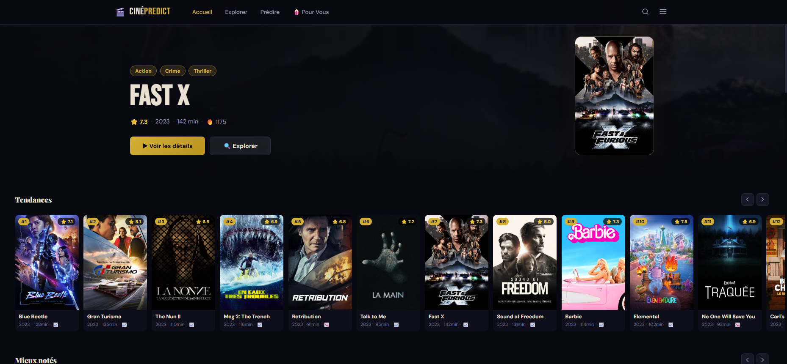
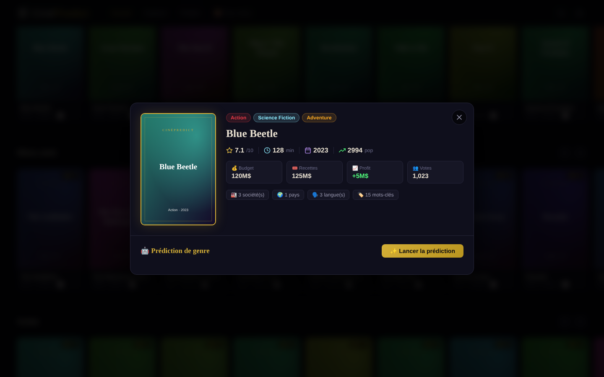
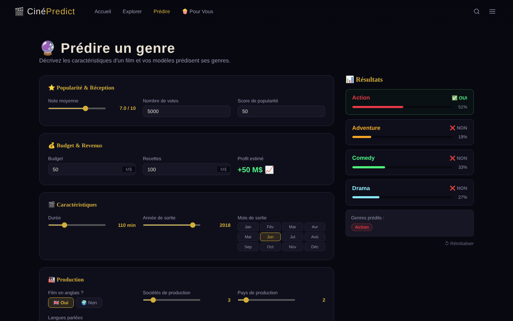
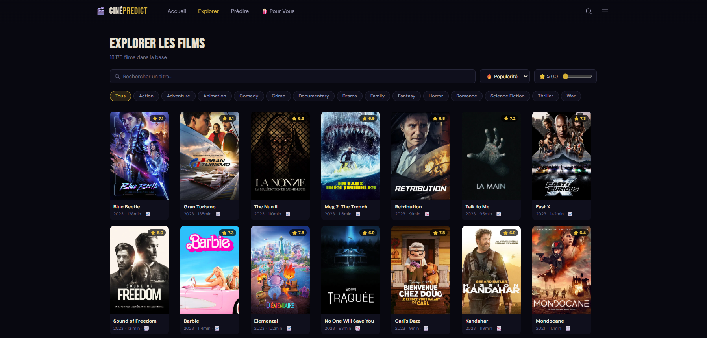
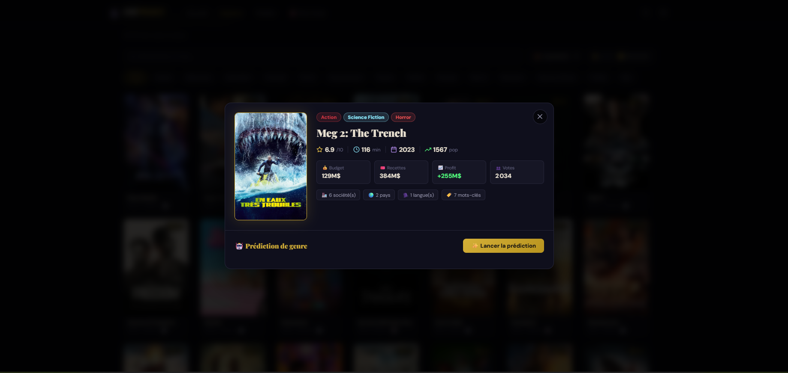
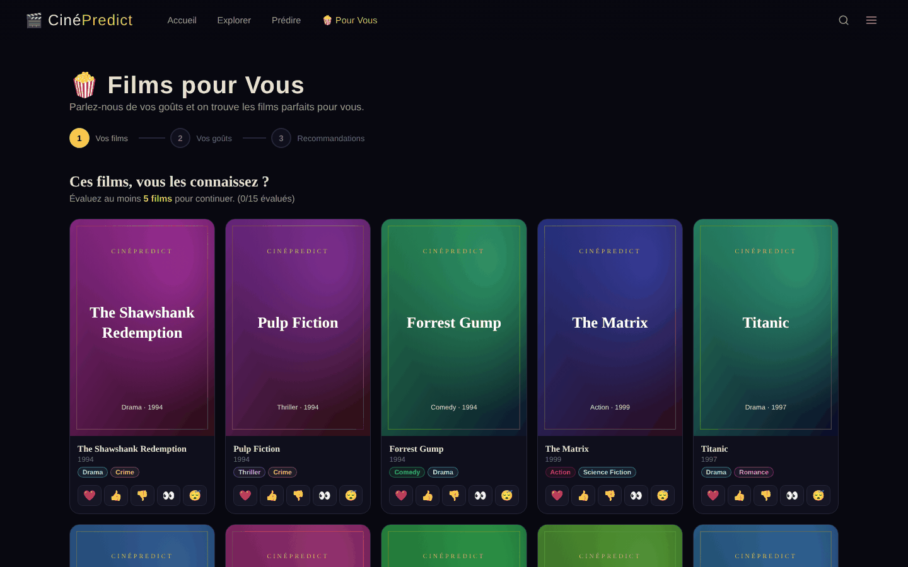
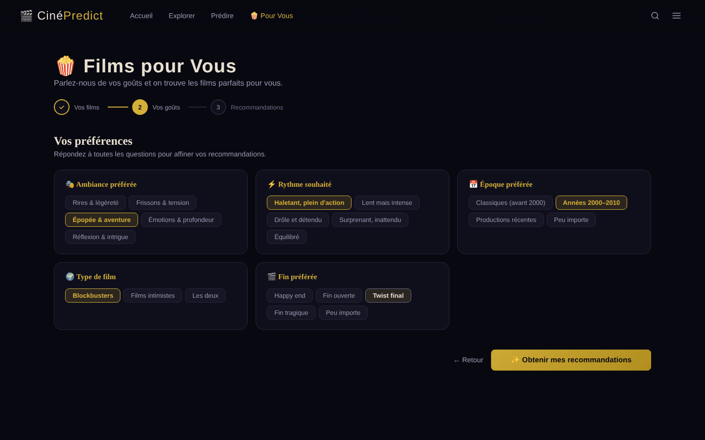
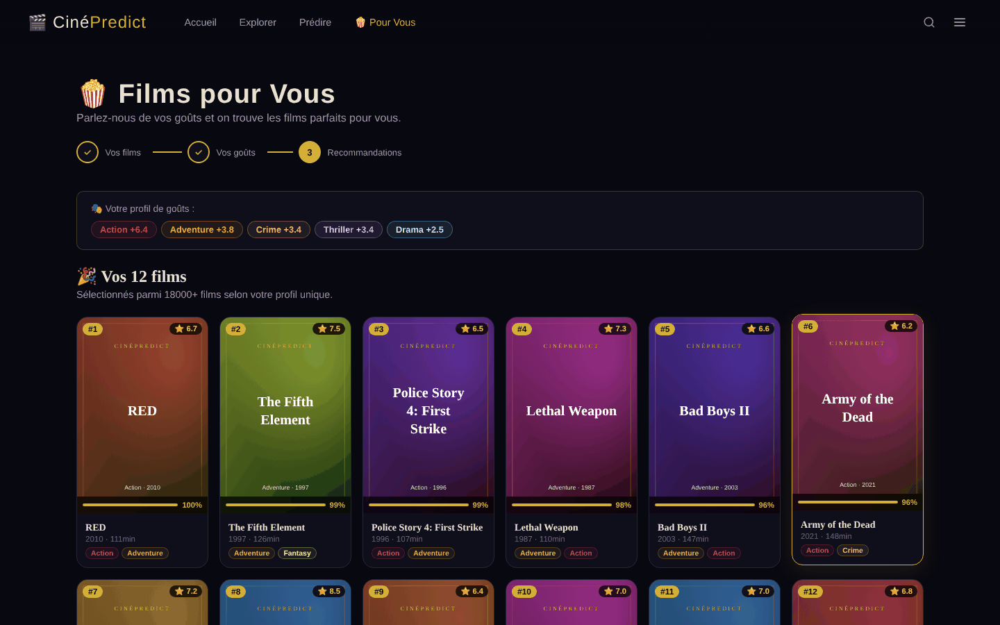
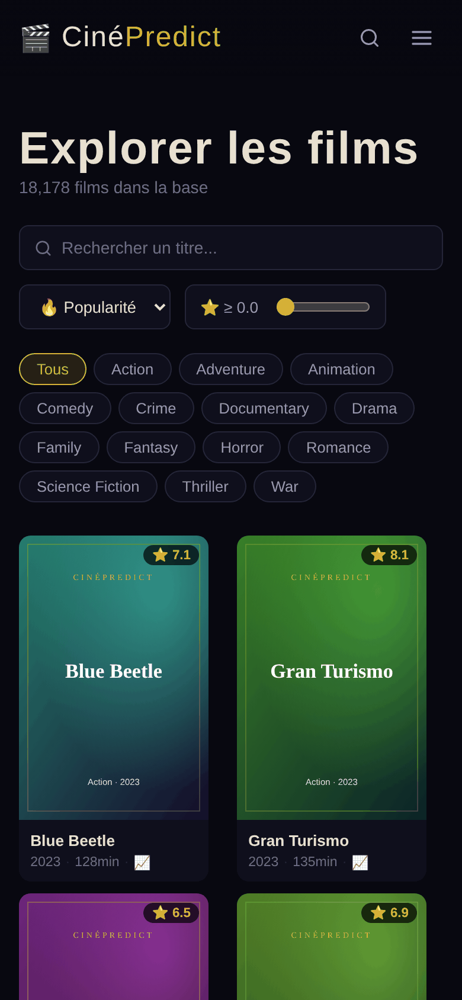

<div align="center">

# 🎬 CinéPredict

**Une plateforme de films qui prédit le genre d'un film à partir de ses chiffres, et qui recommande des films selon vos goûts.**

Machine Learning (LightGBM + XGBoost) · API FastAPI · Interface React




</div>

---

## 📌 Sommaire
- [Le projet en bref](#-le-projet-en-bref)
- [Aperçu](#-aperçu)
- [Comment fonctionne la prédiction](#-comment-fonctionne-la-prédiction)
- [Le moteur de recommandation](#-le-moteur-de-recommandation)
- [Lancer le projet](#-lancer-le-projet)
- [Architecture](#-architecture)
- [API](#-api)
- [Pistes d'amélioration](#-pistes-damélioration)

---

## 🎯 Le projet en bref

Peut-on deviner le **genre d'un film** sans connaître son histoire, seulement à partir de **ses chiffres** :
budget, recettes, durée, note, popularité, date de sortie, nombre de pays de production… ?

CinéPredict répond à cette question avec **4 modèles de Machine Learning**, un par genre
(**Action, Aventure, Comédie, Drame**), entraînés sur **18 178 films** sortis entre 1888 et 2023.
Le tout est servi par une API **FastAPI** et une interface **React** de type plateforme de streaming.

| Fonctionnalité | Ce qu'elle fait |
|---|---|
| 🏠 **Accueil** | Film à la une et carrousels : tendances, mieux notés, Action, Comédie, Sci-Fi, classiques… |
| 🔍 **Explorer** | Recherche par titre, filtre par genre, note minimale, tri, pagination sur les 18 178 films |
| 🔮 **Prédire** | Décrivez un film (réel ou imaginaire) : les modèles donnent la probabilité de chaque genre |
| 🎞️ **Fiche film** | Chiffres clés + prédiction en un clic, **comparée aux vrais genres** du film |
| 🍿 **Pour vous** | Un quiz (15 films + 5 questions de goûts) qui génère 12 recommandations personnalisées |

---

## 📸 Aperçu

| Prédiction depuis la fiche d'un film | Prédire le genre d'un film imaginaire |
|---|---|
|  |  |
| *Sur Inception, le modèle voit juste sur les 4 genres : Action ✔ Aventure ✔, ni Comédie ni Drame.* | *Chaque genre reçoit une probabilité ; au-delà du seuil, il est prédit.* |

| Explorer le catalogue | Fiche d'un film |
|---|---|
|  |  |
| *Recherche, filtres par genre, tri et note minimale sur 18 178 films.* | *Chiffres clés du film et bouton pour lancer la prédiction.* |

| Quiz : vos films | Quiz : vos goûts | Vos recommandations |
|---|---|---|
|  |  |  |

<p align="center"><br><em>Version mobile</em></p>

> ℹ️ Avec une clé TMDb, l'application affiche les vraies affiches des films (accueil, catalogue).
> Sans clé, elle **génère ses propres affiches** (dégradé + titre), comme sur les captures de la prédiction et du quiz :
> l'application reste entièrement utilisable (voir [Lancer le projet](#-lancer-le-projet)).

---

## 🤖 Comment fonctionne la prédiction

### Le problème
Un film peut avoir **plusieurs genres** à la fois : c'est un problème **multi-label**.
Plutôt qu'un seul modèle, on entraîne **un classifieur binaire par genre** (« ce film est-il un film d'action : oui / non ? »).

### Les données d'entrée (16 variables)
| Catégorie | Variables |
|---|---|
| Réception | note moyenne, nombre de votes, popularité |
| Argent | budget, recettes, profit |
| Film | durée, année et mois de sortie, film en anglais |
| Production | nb de sociétés de production, de pays, de langues parlées |
| Communication | slogan (oui/non), site officiel (oui/non), nombre de mots-clés |

### Le modèle : un ensemble par vote
Chaque genre a son propre pipeline scikit-learn :

```
Imputation des valeurs manquantes
        │
        ▼
VotingClassifier (vote "soft" = moyenne des probabilités)
 ├── LightGBM  (mise à l'échelle MaxAbs)
 ├── LightGBM  (standardisation)
 ├── XGBoost   (configuration 1)
 └── XGBoost   (configuration 2)
```

Combiner quatre modèles différents rend la prédiction **plus stable** qu'un modèle seul :
les erreurs de l'un sont compensées par les autres.

### Un défi : le déséquilibre des classes
Dans la base, **43 %** des films sont des drames, **36 %** des comédies, mais seulement **20 %** des films d'action
et **13 %** des films d'aventure. Un modèle naïf aurait tendance à répondre « non » pour les genres rares :
c'est pour cela que la **probabilité** de chaque genre est affichée, pas seulement le oui/non.

---

## 💡 Le moteur de recommandation

La page **Pour vous** construit un **profil de goûts** en deux étapes :

1. **Vos films** : vous notez au moins 5 films parmi 15 classiques (❤️ adoré, 👍 aimé, 👎 pas aimé, 👀 envie de voir, 😴 pas intéressé).
   Chaque réponse ajoute ou retire des points aux genres du film.
2. **Vos goûts** : ambiance, rythme, époque, blockbuster ou film intimiste, type de fin préférée.

Chaque film de la base reçoit ensuite un **score** : affinité avec vos genres préférés + qualité (note)
+ époque et format souhaités + notoriété. Les **12 meilleurs** sont proposés avec un pourcentage de compatibilité.

---

## 🚀 Lancer le projet

### Prérequis
- **Python 3.11 ou plus récent** → [python.org](https://www.python.org/downloads/) (cochez *Add Python to PATH*)
- **Node.js 18 ou plus récent** → [nodejs.org](https://nodejs.org/)

### Option 1 — En un double-clic (Windows)
Double-cliquez sur **`lancer.bat`**.
La première fois, il installe tout automatiquement (quelques minutes), puis ouvre le site sur http://localhost:5173.
Sur macOS / Linux : `./lancer.sh`.

### Option 2 — À la main (deux terminaux)

**Terminal 1 — l'API**
```bash
python -m venv .venv
# Windows : .venv\Scripts\activate     macOS/Linux : source .venv/bin/activate
pip install -r backend/requirements.txt
cd backend
uvicorn api:app --reload --port 8000
```

**Terminal 2 — le site**
```bash
cd frontend
npm install
npm run dev
```
Puis ouvrez **http://localhost:5173**. La documentation interactive de l'API est sur **http://localhost:8000/docs**.

### Affiches des films (optionnel)
1. Créez une clé gratuite sur [themoviedb.org](https://www.themoviedb.org/settings/api).
2. Copiez `.env.example` en `.env` et collez la clé : `TMDB_API_KEY=votre_cle`.
3. Relancez l'API.

Sans clé, tout fonctionne : l'application génère ses propres affiches.

> ⚠️ **Versions des bibliothèques** : les modèles ont été entraînés avec **scikit-learn 1.8** et **NumPy 2**.
> Avec des versions plus anciennes, ils ne se chargent pas. `backend/requirements.txt` fixe les bonnes versions.

---

## 🏗️ Architecture

```
cinepredict/
├── backend/
│   ├── api.py               API FastAPI : films, prédiction, quiz, recommandations
│   └── requirements.txt
├── frontend/                Interface React (Vite)
│   └── src/
│       ├── pages/           Home · Browse · Predict · Quiz
│       ├── components/      Navbar · Carousel · MovieCard · MovieModal
│       └── utils/poster.js  Affiches générées quand TMDb n'est pas disponible
├── models_local/            Un modèle entraîné par genre (.pkl)
│   ├── action/  adventure/  comedy/  drama/
├── movies_features_v3.csv   18 178 films, 16 variables + genres
├── docs/screenshots/        Captures d'écran du README
├── lancer.bat · lancer.sh   Lancement en une commande
└── .env.example             Modèle de configuration (clé TMDb)
```

Le site (port 5173) appelle l'API (port 8000) via le proxy de Vite : toutes les requêtes `/api/...` sont redirigées vers FastAPI.

---

## 🔌 API

| Méthode | Route | Rôle |
|---|---|---|
| `GET` | `/api/status` | Nombre de films, modèles chargés, état de TMDb |
| `GET` | `/api/movies` | Recherche, filtres (genre, années, note), tri, pagination |
| `GET` | `/api/movies/featured` | Film mis à la une |
| `GET` | `/api/movies/carousels` | Données des carrousels de l'accueil |
| `GET` | `/api/movies/{id}` | Détail d'un film |
| `POST` | `/api/predict` | Probabilité de chaque genre à partir des 16 variables |
| `GET` | `/api/quiz/films` · `/api/quiz/questions` | Contenu du quiz |
| `POST` | `/api/recommend` | 12 recommandations + profil de goûts |

Exemple :
```bash
curl -X POST http://localhost:8000/api/predict -H "Content-Type: application/json" \
  -d '{"features": {"vote_average": 8.4, "vote_count": 34495, "popularity": 84, "budget": 160000000,
       "revenue": 825532764, "profit": 665532764, "runtime": 148, "release_year": 2010, "release_month": 7,
       "is_english": 1, "nb_production_companies": 3, "nb_production_countries": 2,
       "nb_spoken_languages": 4, "has_tagline": 1, "has_homepage": 1, "nb_keywords": 20}}'
```
```json
{"Action": {"pred": 1, "proba": 0.717}, "Adventure": {"pred": 1, "proba": 0.767},
 "Comedy": {"pred": 0, "proba": 0.100}, "Drama": {"pred": 0, "proba": 0.225}}
```

---

## 🧭 Pistes d'amélioration
- Ajouter le **notebook d'entraînement** et les **métriques sur un jeu de test** (F1-score par genre, matrice de confusion).
- Étendre la prédiction à d'autres genres (Thriller, Science-Fiction, Horreur…).
- Utiliser le **résumé du film** (NLP) en plus des chiffres pour améliorer la prédiction.
- Déployer l'API (Render, Railway) et le site (Vercel, GitHub Pages) pour une démo en ligne.

---

## 👤 Auteur

**Elie Samson Kombiwo** — Data Scientist (MLOps / LLMOps)
[GitHub](https://github.com/gitsam1path) · [LinkedIn](https://www.linkedin.com/in/elie-samson-kombiwo-4075a4284)

<sub>Données de films issues de TMDb. Ce produit utilise l'API TMDb mais n'est ni approuvé ni certifié par TMDb.</sub>
